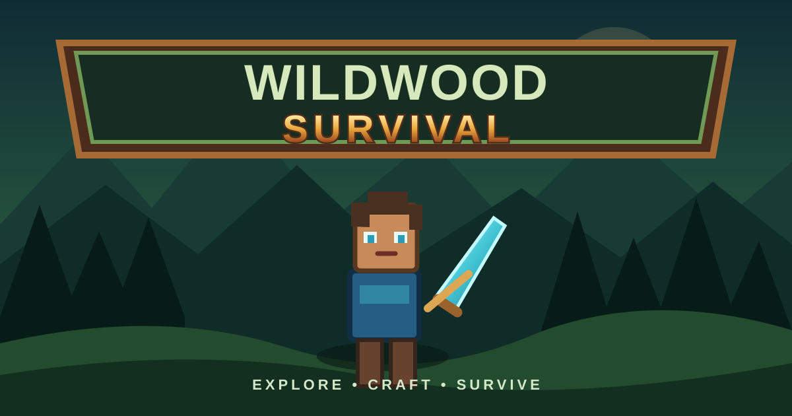

# 🌲 Wildwood Survival

  

**Explore • Craft • Survive**

Wildwood Survival is an Android survival game project. Check the links below for the latest APK build and project updates.

## 📲 Download the Android APK

- **Releases:** https://github.com/Johnperez12345/wildwood-survival/releases
- **Build APK:** https://github.com/Johnperez12345/wildwood-survival/actions/workflows/build-apk.yml
- **Publish APK:** https://github.com/Johnperez12345/wildwood-survival/actions/workflows/publish-apk.yml

> If there is no release yet, open **Actions → Publish Wildwood Survival APK → Run workflow** and run version `v1.0.0`. Wait for the workflow to finish successfully, then download the APK from Releases.

## 🛠️ Project

The Android build project and game update scripts are stored in this repository. The thumbnail above is the repository/game-page artwork; the Android launcher icon is a separate asset that must be configured in the Android app project before rebuilding the APK.
